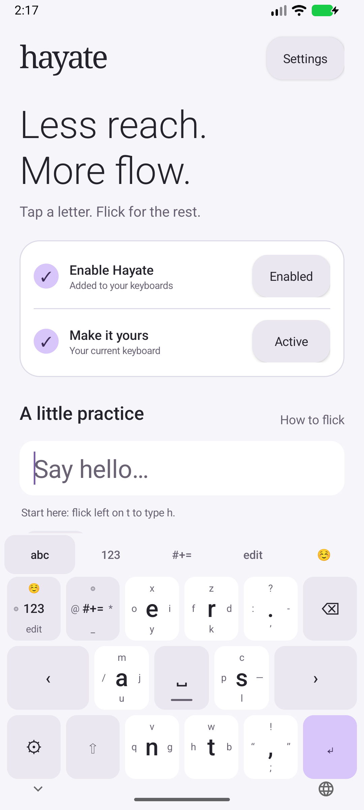
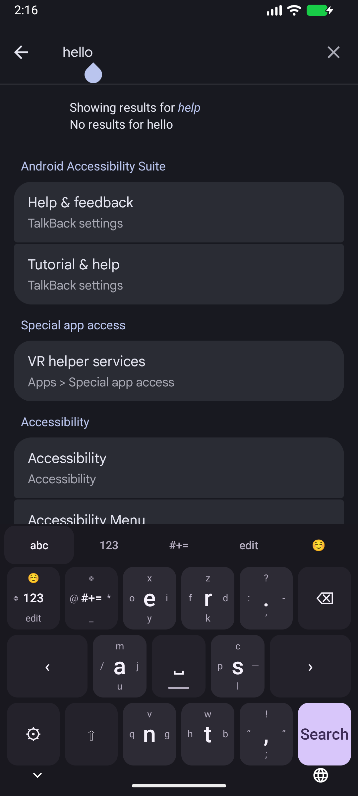

# Hayate

A lighter touch for Android. Six letter keys, all 26 letters, and short directional flicks.

Hayate is a small, offline Android keyboard inspired by the HoneyKey Latin layout. Tap a large letter or flick toward a smaller one. It is a real Android input method, usable across apps.

<p>


</p>

## Install

Download `hayate-0.1.0.apk` from [Releases](https://github.com/farhanakhtar0x66/hayate/releases).

1. Install the APK on Android 8.0 or newer. Android may ask you to allow installation from your browser or file manager.
2. Open **Hayate**, tap **Enable**, and enable Hayate in Android keyboard settings.
3. Return to Hayate, tap **Choose**, and select it as your keyboard.
4. Follow the hints to type **hello** in the practice area.

Android displays its standard keyboard warning when enabling any third-party keyboard. Hayate has no network permission and does not store typed text. See [PRIVACY.md](PRIVACY.md).

## Type

| Key | Tap | Left | Up | Right | Down |
| --- | --- | --- | --- | --- | --- |
| e | e | o | x | i | y |
| r | r | f | z | d | k |
| a | a | / | m | j | u |
| s | s | p | c | — | l |
| n | n | q | v | g | — |
| t | t | h | w | b | — |

The dash in an empty cell means that direction falls back to the center. The s/right cell types an actual em dash.

- **Shift:** once for one capital, twice for caps lock, again to turn it off.
- **Delete:** tap to erase, hold to repeat. Selected text and common emoji sequences delete together.
- **Space:** tap for space; drag horizontally to move the cursor.
- **Tabs:** letters, numbers, symbols, editing, and a curated emoji selection.
- **Edit:** select all, cut/copy/paste, arrows, home/end, undo/redo. Editor support for individual operations varies by app.
- **Return:** follows the field’s Search, Go, Next, Send or Done action; inserts a newline in multiline fields.
- **◎:** opens Android’s keyboard picker. **⚙:** opens Hayate settings.
- **Accessibility:** keys expose center and directional labels; the accessibility long-click action opens tappable character choices.

Settings include light/dark/system appearance, three flick distances, three key heights and optional haptics. Number, phone and date/time fields open the number layer automatically. The launcher practice area works before Hayate is enabled.

## Build and test

Install a full JDK 21 and Android SDK 36 with build-tools 36.0.0. Set `ANDROID_HOME`, or put `sdk.dir=/your/android/sdk` in an ignored `local.properties` file.

```sh
./gradlew testDebugUnitTest lintDebug assembleDebug assembleRelease
# With an emulator/device connected:
./gradlew connectedDebugAndroidTest
```

The Gradle wrapper pins Gradle 9.5.0; the Android plugin is 9.2.1. Java is compiled at language level 17. There are no runtime dependencies. JUnit is test-only. Framework-only device tests exercise real Views and EditText input connections.

Debug APK: `app/build/outputs/apk/debug/app-debug.apk`.
Optimized unsigned release: `app/build/outputs/apk/release/app-release-unsigned.apk`.

To sign an optimized release locally:

```sh
./scripts/sign-release.sh
```

The script creates a private local signing key under `.signing/` on first use. **Keep a secure backup of that directory**: future APK updates must use the same key. It is excluded from Git. Output: `dist/hayate-0.1.0.apk`. CI builds debug and unsigned release artifacts; it does not receive the local signing key.

## Design and scope

A native `InputMethodService`, a small gesture/layout/state core, and lightweight custom key Views. No WebView, UI framework, prediction engine, accounts, ads, analytics, or background network work. Gesture decisions happen on release, drawing updates on input, and delete callbacks stop on cancel/detach.

Version 0.1 is an English directional flick keyboard. It does not implement QWERTY word-glide, autocorrect, prediction, multilingual layouts, a full emoji search engine or inline autofill suggestions. It has not been benchmarked against other keyboards; “fast” is a design goal, not a measured comparative claim. Device testing and release limitations are recorded in [docs/VALIDATION.md](docs/VALIDATION.md).

The supplied HoneyKey screenshots/layout informed the key arrangement. The app implementation and branding are original; this project is not affiliated with HoneyKey. No personal email macro from the reference was included.
