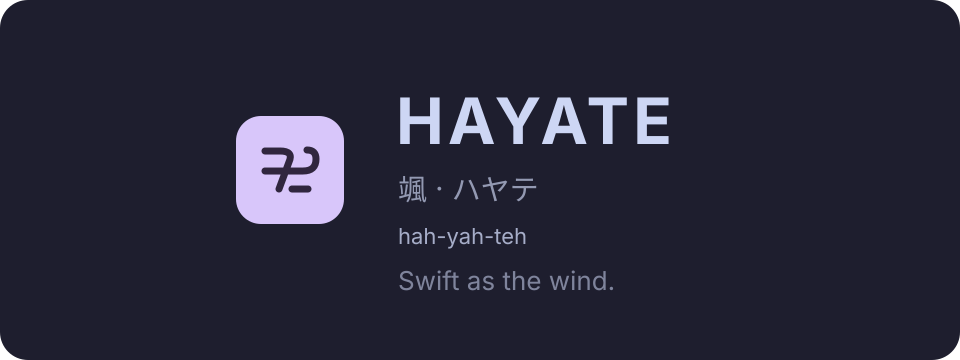
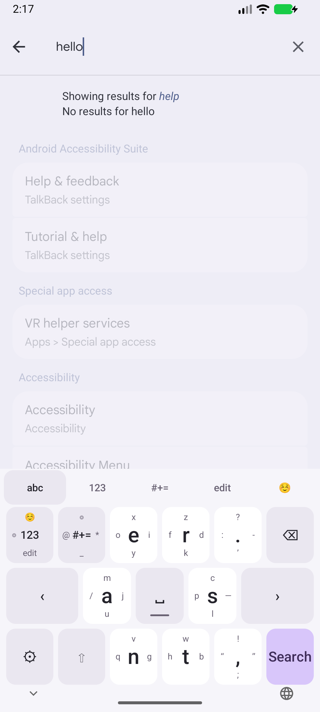
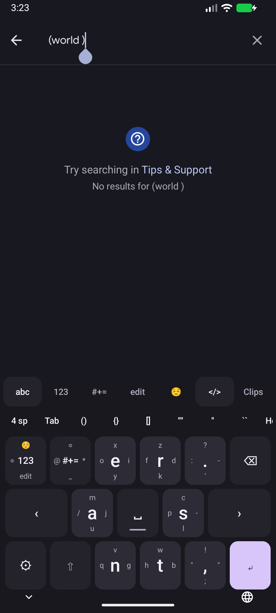

<p align="center">
  
</p>

<p align="center">
  <a href="https://github.com/farhanakhtar0x66/hayate/actions/workflows/android.yml"></a>
  <a href="https://github.com/farhanakhtar0x66/hayate/releases/latest"></a>
  <a href="LICENSE"></a>
  
  <a href="PRIVACY.md"></a>
</p>

<p align="center"><strong>Six letter keys. All 26 letters. A lighter touch for Android.</strong><br>
Hayate <strong>(hah-yah-teh)</strong> · 颯 · ハヤテ<br>
<a href="https://github.com/farhanakhtar0x66/hayate/releases/latest">Download for Android</a> · <a href="#type">Learn to flick</a> · <a href="CONTRIBUTING.md">Contribute</a></p>

<p align="center">Hayate is a small, offline Android keyboard inspired by the HoneyKey Latin layout. Tap a large letter or flick toward a smaller one. It is a real Android input method, usable across apps.</p>

<p align="center">


</p>

## Install

Download `hayate-0.2.0.apk` from [Releases](https://github.com/farhanakhtar0x66/hayate/releases).

1. Install the APK on Android 8.0 or newer. Android may ask you to allow installation from your browser or file manager.
2. Open **Hayate**, tap **Enable**, and enable Hayate in Android keyboard settings.
3. Return to Hayate, tap **Choose**, and select it as your keyboard.
4. Follow the hints to type **hello** in the practice area.

Android displays its standard keyboard warning when enabling any third-party keyboard. Hayate has no network permission and does not store typed text. See [PRIVACY.md](PRIVACY.md).

## Type

| Key | Tap | Left | Up | Right | Down |
| --- | --- | --- | --- | --- | --- |
| e | e | o | x | i | y |
| r | r | f | z | d | k |
| a | a | / | m | j | u |
| s | s | p | c | — | l |
| n | n | q | v | g | — |
| t | t | h | w | b | — |

The dash in an empty cell means that direction falls back to the center. The s/right cell types an actual em dash.

- **Shift:** once for one capital, twice for caps lock, again to turn it off.
- **Delete:** tap to erase, hold to repeat. Selected text and common emoji sequences delete together.
- **Space:** tap for space; drag horizontally to move the cursor.
- **Tabs:** letters, numbers, symbols, editing, and a curated emoji selection.
- **Edit:** select all, cut/copy/paste, arrows, home/end, undo/redo. Editor support for individual operations varies by app.
- **Return:** follows the field’s Search, Go, Next, Send or Done action; inserts a newline in multiline fields.
- **◎:** opens Android’s keyboard picker. **⚙:** opens Hayate settings.
- **Accessibility:** keys expose center and directional labels; the accessibility long-click action opens tappable character choices.

- **Suggestions:** tap a word above the keys to complete or correct the current word. The first choice keeps your spelling. All suggestions run offline using [JSymSpell](https://github.com/rxp90/jsymspell); typing is never silently corrected. English completion and one-edit spelling alternatives are supported, without next-word prediction or personal learning. Password, email, URL, and no-suggestions fields suppress the row’s choices.
- **Clips:** opens Android’s current text clipboard. Tap a clip to paste; × removes it and Clear clears the shelf and current system clip. Optional **Keep recent clips** retains up to ten text clips in memory for one hour, captured while Hayate is visible. It starts off, excludes clips marked sensitive, and saves nothing to disk. Sensitive current clips have a hidden preview and can be pasted explicitly. Clipboard is hidden in password fields. Image/file clips are not previewed.
- **</>:** toggles programmer mode. Letter flicks stay familiar, punctuation becomes straight ASCII, and suggestions/automatic capitalization pause. The shortcut row inserts four spaces, a literal tab, or paired brackets/quotes (wrapping selected text). Swipe the row for Home/End. The **#+=** tab opens coding symbols and operators. Return carries the current indentation and adds four spaces after `{`, `(`, `[` or `:`. Editor support for literal tabs and selection operations varies.

Settings include light/dark/system appearance, three flick distances, three key heights and optional haptics. Number, phone and date/time fields open the number layer automatically. The launcher practice area works before Hayate is enabled.

## Build and test

Install a full JDK 21 and Android SDK 36 with build-tools 36.0.0. Set `ANDROID_HOME`, or put `sdk.dir=/your/android/sdk` in an ignored `local.properties` file.

```sh
./gradlew testDebugUnitTest lintDebug assembleDebug assembleRelease
# With an emulator/device connected:
./gradlew connectedDebugAndroidTest
```

The Gradle wrapper pins Gradle 9.5.0; the Android plugin is 9.2.1. Java is compiled at language level 17. The sole runtime library is `io.gitlab.rxp90:jsymspell:1.0` (MIT). JUnit is test-only. Framework-only device tests exercise real Views and EditText input connections.

Debug APK: `app/build/outputs/apk/debug/app-debug.apk`.
Optimized unsigned release: `app/build/outputs/apk/release/app-release-unsigned.apk`.

To sign an optimized release locally:

```sh
./scripts/sign-release.sh
```

The script creates a private local signing key under `.signing/` on first use. **Keep a secure backup of that directory**: future APK updates must use the same key. It is excluded from Git. Output: `dist/hayate-0.2.0.apk`. CI builds debug and unsigned release artifacts; it does not receive the local signing key.

## Design and scope

A native `InputMethodService`, a small gesture/layout/state core, and lightweight custom key Views. Suggestions load and query a bundled 30,000-word dictionary on a worker thread. Stale results are discarded and candidate insertion revalidates editor context. No WebView, accounts, ads, analytics, or background network work. Gesture decisions happen on release, drawing updates on input, and delete callbacks stop on cancel/detach.

Version 0.2 is an English directional flick keyboard. It does not implement QWERTY word-glide, automatic correction, next-word prediction, multilingual layouts, a full emoji search engine, IDE completion or inline autofill suggestions. It has not been benchmarked against other keyboards; “fast” is a design goal, not a measured comparative claim. Device testing and release limitations are recorded in [docs/VALIDATION.md](docs/VALIDATION.md).

## Credits

**HoneyKey Latin was designed by [u/thefizzynator](https://www.reddit.com/user/thefizzynator/).** Hayate’s letter arrangement and directional flick interaction are inspired by their [original smartphone keyboard post](https://www.reddit.com/r/KeyboardLayouts/comments/no9sbc/i_designed_a_keyboard_layout_for_smartphones/). Thank you for sharing the design. The same credit and link appear in Hayate’s Credits screen.

Suggestions reuse **JSymSpell by Raul Garcia**, based on **SymSpell by Wolf Garbe**, rather than a new correction algorithm. The bundled frequency list is a 30,000-entry subset of SymSpell’s English dictionary, derived from Google Books Ngram and SCOWL. Clipboard uses Android’s platform `ClipboardManager`. See [THIRD_PARTY_NOTICES.txt](THIRD_PARTY_NOTICES.txt) for licenses, provenance and exact dictionary revision; these notices are also bundled in the APK under Credits → Licenses.

Hayate’s app implementation and branding are original. This independent project is not affiliated with or endorsed by HoneyKey, Google, or the engine authors. No personal email macro from the reference was included.

## License

Hayate’s original code and branding are released under the [MIT License](LICENSE). Third-party code and dictionary data retain their respective licenses; see [THIRD_PARTY_NOTICES.txt](THIRD_PARTY_NOTICES.txt). HoneyKey layout inspiration is credited above.
